# Envios Service — Diagnóstico y Mejora Guiada por Métricas

Proyecto Maven (Java 21) que calcula el costo de un envío según el método de
transporte, el peso, la distancia, la fragilidad del paquete y el tipo de
cliente. Se usa para **diagnosticar** la calidad del código con SonarQube y
JaCoCo (Parte 1) y **mejorarlo** con un patrón de diseño, pruebas
significativas y un Quality Gate, comparando métricas reales antes y después
(Parte 2).

## Resumen de resultados

| Métrica | Antes (Parte 1) | Después (Parte 2) |
|---|---|---|
| Complejidad ciclomática de `calcularCosto()` | 20 | **5** (−75 %) |
| Complejidad cognitiva (proyecto) | 32 | **8** (−75 %) |
| Cobertura de ramas | 18.4 % | **100 %** (+81.6 puntos) |
| Quality Gate "Estándar Laboratorio" | — | **Passed** |

## Decisiones de diseño

| # | Tema | Elección |
|---|---|---|
| 1 | Entorno de análisis | SonarQube local con Docker |
| 2 | Exclusiones del análisis | Ninguna |
| 3 | Métrica de diagnóstico | Complejidad cognitiva (apoyada en la ciclomática y la cobertura) |
| 4 | Patrón de diseño | Strategy, con una clase base para la lógica común de tramos |
| 5 | Criterio de pruebas | Una prueba por rama no cubierta, con valores verificados |
| 6 | Realismo del Quality Gate | CC = 10 por método, 70 % de cobertura y 5 % de duplicación |

---

# Parte 1 — Diagnóstico con métricas reales

## Entorno de análisis

**Decisión de diseño 1: SonarQube local con Docker (imagen `sonarqube:community`)**

Elegí ejecutar SonarQube localmente con Docker en lugar de SonarCloud por los
siguientes criterios:

1. **Independencia de conectividad y de límites de plan:** el análisis, el
   Quality Profile y el Quality Gate se ejecutan y configuran sin depender de
   internet ni de las restricciones de un plan gratuito, lo que permitió
   re-ejecutar el análisis las veces necesarias en la Parte 2.
2. **Control total de la configuración:** al administrar mi propia instancia
   pude duplicar el perfil de calidad por defecto ("Sonar way core"), activar
   la regla `java:S1541` con Threshold = 10 y asignar un Quality Gate
   personalizado sin restricciones.
3. **Coherencia con la configuración del proyecto:** el archivo
   `sonar-project.properties` apunta a `http://localhost:9000`, y el proyecto
   puede analizarse sin estar publicado previamente en un repositorio remoto.

**Costo asumido:** Docker consume recursos de la máquina local (aprox. 2 GB de
RAM) y el contenedor debe mantenerse en ejecución durante todo el laboratorio.
Lo acepté porque el proyecto es pequeño y el beneficio en control y
repetibilidad supera ese costo.

**Configuración:** SonarQube Community Build 26.10, proyecto `envios-service`,
project key `com.universidad:envios-service`, autenticación mediante token de
análisis (no incluido en el repositorio por seguridad; se pasa por línea de
comandos con `-Dsonar.token`).

**Decisión de diseño 2: Exclusiones del análisis — no se excluye ninguna clase**

No configuré `sonar.exclusions` y analizo todo el código de `src/main/java`.

1. **No existe código sin lógica propia.** El proyecto es un Maven plano (sin
   Spring Boot) y no tiene clase `Main`, controladores, configuración ni DTOs.
   Toda clase de producción contiene lógica de negocio.
2. **Excluir distorsionaría la métrica.** Dejar fuera `ServicioCalculoEnvio`
   ocultaría justamente el problema que el laboratorio busca diagnosticar
   (complejidad alta y cobertura baja). Excluir código para "mejorar" el
   porcentaje sería maquillar el resultado.
3. **Aplica también a la Parte 2.** Las clases del paquete `estrategia`
   contienen fórmulas de cálculo reales, por lo que se miden y no se excluyen.

Si el proyecto incorporara una clase de arranque sin lógica propia, sería
razonable excluirla con `sonar.exclusions` para que su falta de pruebas no
distorsione la cobertura global.

## Estado inicial del análisis

Valores observados en el dashboard de SonarQube y en el reporte HTML de JaCoCo
tras ejecutar `mvn clean verify sonar:sonar`, antes de modificar el código.

| Métrica | Valor real observado |
|---------|----------------------|
| Complejidad ciclomática de `calcularCosto()` | 20 |
| Complejidad cognitiva de `calcularCosto()` | 32 |
| Cobertura de líneas de `ServicioCalculoEnvio` | 23.8 % (32 de 42 líneas sin cubrir) |
| Cobertura de ramas de `ServicioCalculoEnvio` | 18.4 % en SonarQube (31 de 38 condiciones sin cubrir); 18 % en JaCoCo (31 de 38 ramas sin cubrir) |
| Cobertura global (líneas + ramas) | 21.3 % |
| Code Smells reportados | 0 |
| Líneas duplicadas | 0.0 % |
| Pruebas ejecutadas | 2 (sin fallos) |
| Quality Gate (por defecto) | Passed |

## Interpretación

**Qué método concentra el problema.** `ServicioCalculoEnvio.calcularCosto()` es
el único método con lógica de la clase (el constructor por defecto tiene
complejidad 1 y 100 % de cobertura), por lo que la complejidad de la clase
(20) es la del método. La complejidad alta y la cobertura baja apuntan al
mismo método: `calcularCosto()` concentra una cadena de cuatro métodos de
envío, tramos de peso, recargos por distancia, fragilidad y tipo de cliente,
y la suite inicial solo ejercita dos caminos (ESTANDAR con peso menor a 5 kg,
con cliente REGULAR y PREMIUM). Con 20 caminos independientes frente a 2
pruebas, es esperable que la cobertura de ramas sea baja.

**Ramas sin cubrir según el reporte JaCoCo** (solo 7 de 38 ramas cubiertas):

| Zona del método (líneas) | Estado |
|---|---|
| `ESTANDAR`, tramos de peso 5–20 kg y mayor a 20 kg (12–15) | Sin ejecutar |
| `ESTANDAR`, recargo `distanciaKm > 500` (17–18) | Solo la rama falsa cubierta |
| Bloque completo `EXPRESS` (20–31) | Sin ejecutar |
| Bloque completo `OVERNIGHT`, incluida la excepción de más de 300 km (32–42) | Sin ejecutar |
| Bloque completo `INTERNACIONAL`, incluido el recargo de más de 5000 km (43–52) | Sin ejecutar |
| Excepción de método de envío no soportado (54–55) | Sin ejecutar |
| Recargo por fragilidad `esFragil` (58–59) | Solo la rama falsa cubierta |
| Descuento `CORPORATIVO` (64–65) | Evaluado, pero nunca verdadero |

**Decisión de diseño 3: métrica usada como señal principal — Cognitive Complexity**

En este proyecto las tres señales (complejidad ciclomática, complejidad
cognitiva y cobertura) coinciden en `calcularCosto()`, porque es el único
método con lógica. Aun así, usé la **complejidad cognitiva (32)** como señal
principal para elegir el método a intervenir, por estas razones:

1. **Es mayor que la ciclomática (32 frente a 20).** La diferencia de 12
   puntos viene de la penalización por anidamiento: los `if` de tramos de
   peso están dentro de cada bloque de método de envío. La ciclomática solo
   cuenta caminos; la cognitiva refleja además lo difícil que es leer el
   método, que es el verdadero costo de mantenerlo.
2. **Apunta a la causa, no solo al síntoma.** El anidamiento por método de
   envío es justamente lo que un patrón de diseño puede eliminar, mientras
   que la cobertura baja es consecuencia de tener tantos caminos.
3. **Uso complementario de las otras dos.** La complejidad ciclomática (20)
   es la métrica con la que medí la reducción antes y después (y la que
   controla la regla `java:S1541` del Quality Profile), y la cobertura de
   ramas guió qué pruebas escribir en la Parte 2.

**Hallazgo adicional: 0 Code Smells a pesar de la complejidad alta.**
`calcularCosto()` tiene complejidad ciclomática 20 y complejidad cognitiva 32,
y aun así SonarQube reporta 0 Code Smells. La causa es de configuración, no de
código: el perfil de calidad que usa el proyecto ("Sonar way core", 274 reglas
activas para Java) no activa ninguna de las dos reglas que miden estos valores:

| Regla | Umbral por defecto | Perfiles donde está activa | ¿Activa en "Sonar way core"? |
|---|---|---|---|
| `java:S1541` (Methods should not be too complex) | 10 | ninguno | No |
| `java:S3776` (Cognitive Complexity of methods should not be too high) | 15 | Sonar way extended, comprehensive y agentic AI | No |

Con los umbrales por defecto (10 y 15), los valores 20 y 32 superarían ambos
límites, por lo que el método sería reportado si las reglas estuvieran
activas. Esto confirma que una métrica de complejidad no genera alertas por
sí sola: hay que activar la regla y fijar el umbral de forma explícita en un
Quality Profile, lo que se hace en la Parte 2.

## Capturas del análisis inicial

### Dashboard de SonarQube


### Complejidad ciclomática (20)


### Complejidad cognitiva (32)


### Cobertura de líneas (23.8 %)


### Cobertura de ramas (18.4 %)


### Reporte HTML de JaCoCo


### JaCoCo: ramas sin cubrir en el código de `calcularCosto()`


### Reglas de complejidad no activas en el perfil del proyecto


---

# Parte 2 — Refactorización guiada por métricas

## Decisión de diseño 4: patrón elegido — Strategy

Antes de refactorizar analicé qué naturaleza tienen los condicionales de
`calcularCosto()` frente a los tres candidatos:

| Candidato | Señal que lo identifica | ¿Se cumple en `calcularCosto()`? |
|---|---|---|
| **State** | El objeto recuerda su estado entre llamadas y el estado condiciona las transiciones válidas | **No.** `ServicioCalculoEnvio` no tiene atributos mutables: el costo depende únicamente de los cinco parámetros de entrada, sin memoria entre llamadas ni transiciones |
| **Chain of Responsibility** | El orden de evaluación importa y varios manejadores podrían aplicar antes de llegar al que resuelve | **No.** Los cuatro métodos de envío son mutuamente excluyentes y el orden en que se comparan es irrelevante: solo uno puede coincidir |
| **Strategy** | Cada rama calcula el mismo tipo de resultado con una fórmula propia, elegida una sola vez por un valor discreto | **Sí.** Cada valor de `metodoEnvio` (ESTANDAR, EXPRESS, OVERNIGHT, INTERNACIONAL) produce un costo con su propia tarifa, recargos y reglas, sin relación de orden ni de estado con las demás ramas |

**Por qué descarto State:** el método no guarda ningún estado. Dos llamadas
con los mismos parámetros devuelven siempre el mismo resultado, sin importar
qué se calculó antes.

**Por qué descarto Chain of Responsibility:** aunque `if / else if` parece una
cadena, en ella solo una rama puede cumplirse y ninguna "pasa" la solicitud a
la siguiente. Tampoco lo son los ajustes de fragilidad y tipo de cliente: se
aplican siempre los dos, en secuencia, sin que ninguno resuelva y detenga el
flujo, por lo que son un pipeline de ajustes y no una cadena de manejadores.
Los tramos de peso (`< 5`, `< 20`, resto) tampoco lo son: son rangos de una
sola variable dentro de cada fórmula.

**Estructura resultante:**

```
src/main/java/com/universidad/enviosservice/
├── service/
│   └── ServicioCalculoEnvio.java        ← orquestador (CC = 5)
└── estrategia/
    ├── EstrategiaEnvio.java             ← interfaz común
    ├── EnvioPorTramosStrategy.java      ← lógica común de tramos (clase base)
    ├── EnvioEstandarStrategy.java
    ├── EnvioExpressStrategy.java
    ├── EnvioOvernightStrategy.java      ← conserva la validación de 300 km
    └── EnvioInternacionalStrategy.java
```

**Qué se movió a las estrategias:** la tarifa de cada método de envío (costo por
km, cargo fijo, tarifas por tramo de peso, recargo por distancia y, en
`EXPRESS`, el multiplicador de 1.3). En `OVERNIGHT` además la validación de
máximo 300 km.

**Qué se quedó deliberadamente en el orquestador:** el recargo por fragilidad
y el descuento por tipo de cliente. Son reglas transversales que se aplican
igual a los cuatro métodos de envío y no forman parte de "qué fórmula usar".
Moverlas a las estrategias duplicaría esa lógica cuatro veces y obligaría a
modificar cuatro clases ante un cambio de política de descuentos. Por eso la
complejidad del orquestador no baja a 1: queda en 5 (1 base + estrategia nula
+ fragilidad + los dos tramos de tipo de cliente), dentro del rango "Moderada".

**Evolución: de cuatro `if/else` a una clase base.** Mi primera versión de las
estrategias escribía en cada clase la estructura de tramos de peso y recargo
por distancia. El primer análisis posterior al refactor reportó 13.3 % de
duplicación: SonarQube marcó 2 bloques (28 líneas) entre `EnvioEstandarStrategy`
y `EnvioExpressStrategy`, y el Quality Gate falló (ver "Iteración"). Las otras
dos estrategias tenían la misma estructura con términos adicionales (cargo
fijo), que SonarQube no marcó pero que seguían repitiendo la mecánica. Extraje
esa estructura a `EnvioPorTramosStrategy`: cada estrategia concreta solo
declara sus tarifas, y `EnvioOvernightStrategy` agrega su validación de
distancia. Sigue siendo Strategy (cuatro algoritmos intercambiables elegidos
por `metodoEnvio`); la herencia solo evita repetir la mecánica de cálculo. Las
30 pruebas siguieron pasando sin modificarlas, lo que confirma que el
comportamiento se conservó.

## Decisión de diseño 5: criterio de las pruebas agregadas

El reporte JaCoCo de la Parte 1 dejó 31 de 38 ramas sin cubrir. Cada prueba
nueva corresponde a una de ellas; no agregué pruebas que repitan un caso ya
cubierto.

| Rama sin cubrir en la Parte 1 (líneas del método original) | Prueba que la cubre | Valor que verifica |
|---|---|---|
| `ESTANDAR`, tramos de peso de 5–20 kg y de 20 kg o más (12–15) | `EnvioEstandarStrategyTest.calculaCostoPorTramoDePeso` | 52.4 y 68.0 |
| `ESTANDAR`, recargo `distanciaKm > 500` (17–18) | `EnvioEstandarStrategyTest.aplicaRecargoSoloSobre500Km` | 250.0 (límite) y 260.5 |
| Bloque `EXPRESS`: tramos, recargo y multiplicador 1.3 (20–31) | `EnvioExpressStrategyTest` (ambos métodos) | 156.0, 161.85, 198.25, 780.0 y 814.06 |
| Bloque `OVERNIGHT`: tramos de peso (36–42) | `EnvioOvernightStrategyTest.calculaCostoPorTramoDePeso` | 220.0, 227.5 y 272.5 |
| `OVERNIGHT`, excepción de más de 300 km (33–34) | `rechazaDistanciasMayoresA300Km` y `aceptaExactamente300Km` | excepción con su mensaje y 620.0 |
| Bloque `INTERNACIONAL`: tramos y recargo `> 5000` (43–52) | `EnvioInternacionalStrategyTest` (ambos métodos) | 1850.0, 1859.0, 1917.5, 9050.0 y 9151.8 |
| Excepción de método no soportado (54–55) | `ServicioCalculoEnvioTest.rechazaMetodoDeEnvioNoSoportado` | excepción con su mensaje |
| Recargo por fragilidad (58–59) | `ServicioCalculoEnvioTest.aplicaRecargoPorFragilidad` | 57.5 |
| Descuento `CORPORATIVO`, nunca verdadero (64–65) | `ServicioCalculoEnvioTest.aplicaDescuentoClienteCorporativo` | 42.5 |

**Criterios aplicados:**

1. **Un caso por rama, con valor distinto.** Cada tramo de peso tiene su propio
   resultado esperado, obtenido aplicando la fórmula de la tarifa al caso.
2. **Límites donde el resultado cambia.** Probé 500/501 km, 5000/5001 km y
   300/301 km, porque ahí el costo salta (por ejemplo, 250.0 frente a 260.5)
   y se detecta un `>` convertido en `>=`. No probé los pesos exactos 5.0 y
   20.0: las fórmulas son continuas en esos puntos y ambas ramas dan el mismo
   costo, así que la prueba no distinguiría nada y sería redundante.
3. **Verificación del valor, no solo de la ejecución.** Todas usan
   `assertEquals` con el costo esperado o `assertThrows` comparando el mensaje.
4. **Pruebas de integración del orquestador.** `delegaCadaMetodoEnSuEstrategia`
   comprueba que cada clave del mapa apunta a su estrategia (si se
   intercambiaran EXPRESS y OVERNIGHT, las pruebas de las estrategias seguirían
   pasando, pero esta fallaría), y `combinaFragilidadYDescuentoPremium`
   verifica que ambos ajustes se compongan correctamente.
5. **Las dos pruebas originales se conservan sin cambios**, como base
   documentada de la Parte 1.

La suite pasó de 2 a 30 pruebas (5 por cada estrategia y 10 en el
orquestador). No se prueban entradas nulas (por ejemplo `tipoCliente = null`),
porque el enunciado del laboratorio no define el comportamiento esperado en
ese caso.

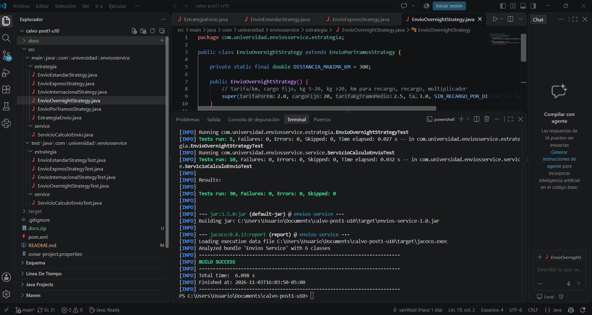

## Quality Profile y Quality Gate

**Quality Profile "Estándar Laboratorio".** Es una copia del perfil
"Sonar way core" (el perfil built-in no es editable) con la regla
`java:S1541` ("Methods should not be too complex") activada, severidad de
mantenibilidad *High* y **Threshold = 10**. El perfil tiene 276 reglas activas
para Java (las 274 del perfil base más 2 añadidas, entre ellas S1541) y está
asignado al proyecto `envios-service`. En la Parte 1 esa regla no estaba
activa en ningún perfil, por lo que la complejidad ciclomática de 20 no
generaba ningún Code Smell.

**Quality Gate "Estándar Laboratorio"**, asignado al proyecto con la opción
"Always use a specific quality gate". Lo creé a partir de una copia de
"Sonar way" y ajusté sus condiciones a las del laboratorio: cobertura mínima de
70 % y duplicación máxima de 5 %, y eliminé *Security Hotspots Reviewed*
porque el proyecto no tiene hotspots. Todas las condiciones son sobre código
nuevo:

| Métrica | Operador | Valor |
|---|---|---|
| Coverage | es menor que | 70 % |
| Issues | es mayor que | 0 |
| Duplicated Lines (%) | es mayor que | 5 % |

El periodo de código nuevo del proyecto ("New Code: Since November 2, 2026")
abarca todo el código: SonarQube cuenta 41 líneas por cubrir en código nuevo y
41 en el código completo, por lo que estas condiciones evalúan efectivamente
todo el proyecto.

SonarQube no permite limitar la complejidad de un método individual desde el
Quality Gate (sus condiciones operan sobre métricas agregadas). El límite por
método se aplica en el Quality Profile con la regla S1541, y el Quality Gate
lo hace cumplir a través de la condición de issues nuevos: cualquier método
que supere CC = 10 genera un issue y hace fallar el gate.

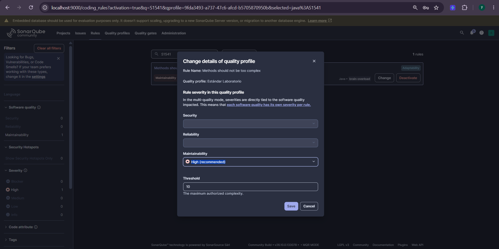
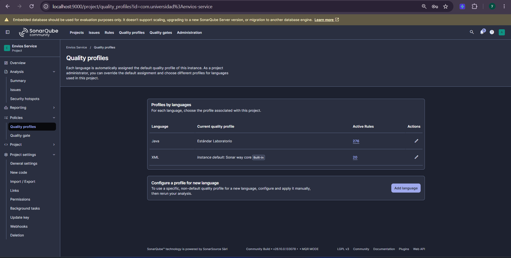
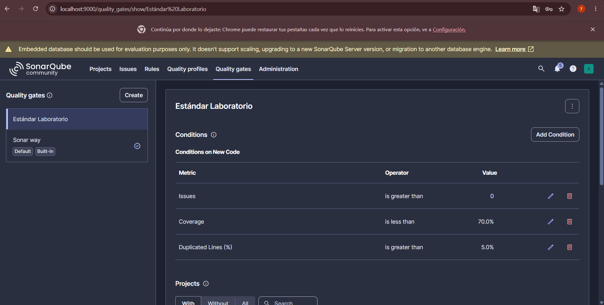
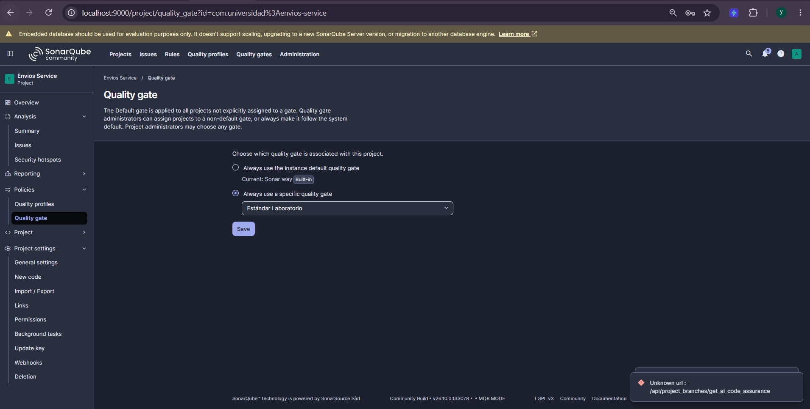

## Decisión de diseño 6: realismo de los umbrales

**Por qué CC = 10 por método (y no 5 ni 20):**

- **Con 20 la regla no habría detectado el problema.** El método original
  tenía complejidad ciclomática exactamente 20, y la regla solo reporta los
  métodos que *superan* el umbral. Un umbral de 20 habría dejado pasar el
  método que justamente quería diagnosticar; con 10 sí se reporta.
- **Con 5 el umbral sería demasiado estricto.** El orquestador refactorizado
  queda en CC = 5: estaría en el límite exacto, y agregar un solo tipo de
  cliente nuevo haría fallar el gate. Esas reglas transversales no deben
  duplicarse en cuatro estrategias solo para bajar un número.
- **10 es el techo del rango "Moderada" de la Tabla 3.2 de la guía** (la
  complejidad original de 20 cae en "Alta" y la del orquestador, 5, en
  "Moderada"), y coincide con el valor por defecto del parámetro Threshold de
  la propia regla S1541, comprobado en su ficha dentro de SonarQube (en mi
  instancia la regla venía inactiva en "Sonar way core"). Es exigente, pero no
  obliga a reescribir métodos que todavía son razonables de mantener.

**Por qué 70 % de cobertura (y no 100 %):** exigir 100 % como umbral es poco
realista y suele producir pruebas triviales que solo llenan el número
(incentivo perverso descrito en la Sección 2.3 de la guía). 70 % es el mismo
ejemplo de umbral que usa la guía y deja margen para código de infraestructura
sin obligar a escribir pruebas vacías. En este proyecto la cobertura final es
100 %, pero porque cada rama tiene una prueba con valor verificado, no porque
el gate lo exija: el umbral funciona como un piso que detecta regresiones, no
como la meta.

**Por qué 5 % de duplicación:** el perfil recomendado de SonarQube usa 3 %,
que fue el umbral con el que se creó el gate. Lo ajusté a 5 % para seguir el
laboratorio: en un proyecto de apenas cien líneas de Java, unos pocos bloques
repetidos pesan mucho, y 5 % es algo más tolerante pero sigue siendo
exigente. Las 28 líneas duplicadas del primer análisis dieron 6.9 % en código
nuevo, por encima de ambos umbrales, así que el gate habría fallado igual.

**Sobre *Issues > 0*:** hace que cualquier issue nuevo bloquee el gate,
incluido el de la regla S1541.

## Iteración: el Quality Gate detectó duplicación

El Quality Gate no fue decorativo: el primer análisis posterior al refactor,
con las cuatro estrategias independientes, falló. El gate se creó como copia
de "Sonar way" (cobertura 80 %, duplicación 3 %) y más tarde lo ajusté a los
umbrales del laboratorio; por eso hay tres análisis en esta historia.

| Análisis | Gate vigente | Duplicación | Cobertura | Issues | Quality Gate |
|---|---|---|---|---|---|
| 1. Estrategias independientes | Copia de "Sonar way" (80 % / 3 %) | **13.3 %** (6.9 % en código nuevo) | 100 % | 0 | **Failed** (1 condición) |
| 2. Con `EnvioPorTramosStrategy` | Copia de "Sonar way" (80 % / 3 %) | **0.0 %** | 100 % | 0 | **Passed** |
| 3. Gate ajustado al laboratorio | "Estándar Laboratorio" (70 % / 5 %) | **0.0 %** | 100 % | 0 | **Passed** (todas las condiciones) |

El Overview del primer análisis mostró "Failed, 1 condition failed" sin
detallar cuál. Por descarte con los valores visibles (cobertura 100 %, 0
issues, sin hotspots), la condición que no se cumplía era la de duplicación:
6.9 % en código nuevo, por encima del 3 % que tenía el gate entonces y también
del 5 % que fijé después. Entre el segundo y el tercer análisis el código no
cambió; solo se ajustó el gate, y las métricas fueron las mismas.

La medición de SonarQube señaló 28 líneas duplicadas en 2 bloques, entre
`EnvioEstandarStrategy` y `EnvioExpressStrategy` (14 líneas cada una,
60.9 %). La causa era real y evitable: las estrategias repetían la misma
estructura de tramos de peso y recargo por distancia, y solo cambiaban las
tarifas. En lugar de subir el umbral, extraje esa lógica a una clase base. Las
pruebas existentes no se modificaron y siguieron pasando.

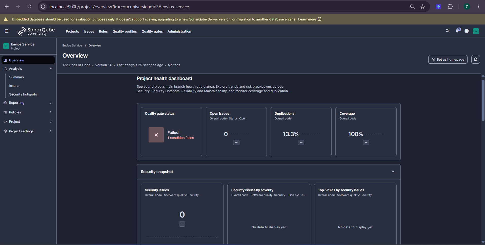
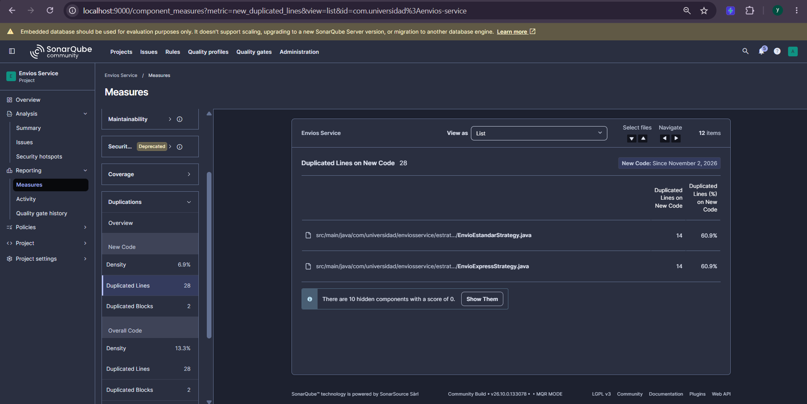

## Comparación antes / después

| Métrica | Antes (Parte 1) | Después (Parte 2) |
|---------|------------------|--------------------|
| Complejidad ciclomática de `calcularCosto()` | 20 | **5** (−75 %) |
| Complejidad ciclomática máxima por archivo | 20 | 5 |
| Complejidad ciclomática total del proyecto | 20 | 16 (−20 %) |
| Complejidad cognitiva total del proyecto | 32 | **8** (−75 %) |
| Cobertura de líneas | 23.8 % | **100 %** (41 de 41) |
| Cobertura de ramas | 18.4 % (7 de 38 cubiertas) | **100 %** (16 de 16) |
| Cobertura global | 21.3 % | **100 %** |
| Code Smells / issues | 0 (regla S1541 inactiva) | 0 (regla S1541 activa, umbral 10) |
| Duplicación | 0.0 % | 0.0 % (13.3 % en la iteración intermedia) |
| Pruebas | 2 | 30 |
| Quality Gate | Passed (gate por defecto "Sonar way") | **Passed** ("Estándar Laboratorio") |

La reducción de complejidad ciclomática por método (75 %) supera el 50 %
esperado, y el aumento de cobertura de ramas (81.6 puntos porcentuales)
supera los 15 esperados. El número de ramas cambió de 38 a 16 porque el código
refactorizado tiene menos condiciones: la estructura de tramos se escribe una
sola vez.

**Distribución de la complejidad.** La complejidad total baja de 20 a 16, pero
lo más importante es cómo se reparte: el método más complejo pasó de 20 a 5.

| Archivo | Complejidad ciclomática (SonarQube) |
|---|---|
| `EnvioPorTramosStrategy.java` | 5 (constructor 1 + `calcular` 4) |
| `ServicioCalculoEnvio.java` | 5 (`calcularCosto`) |
| `EnvioOvernightStrategy.java` | 3 (constructor 1 + `calcular` 2) |
| `EnvioEstandarStrategy.java` | 1 |
| `EnvioExpressStrategy.java` | 1 |
| `EnvioInternacionalStrategy.java` | 1 |
| `EstrategiaEnvio.java` | 0 |

JaCoCo reporta 17 en total porque también cuenta el constructor por defecto de
`ServicioCalculoEnvio` (complejidad 1), que SonarQube no incluye. Ningún
método supera el umbral de 10 del Quality Profile.

## Capturas del análisis final

### Dashboard de SonarQube (código completo)

Tomada en el análisis 2, antes de ajustar el gate; las métricas son idénticas
a las del análisis 3.

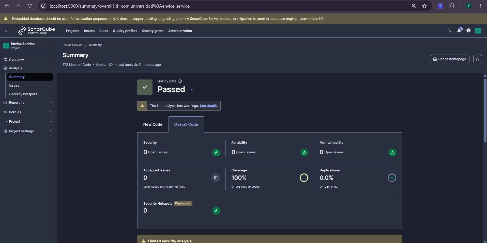

### Quality Gate "Estándar Laboratorio" aprobado

Último análisis, con las condiciones del laboratorio (70 % y 5 %).

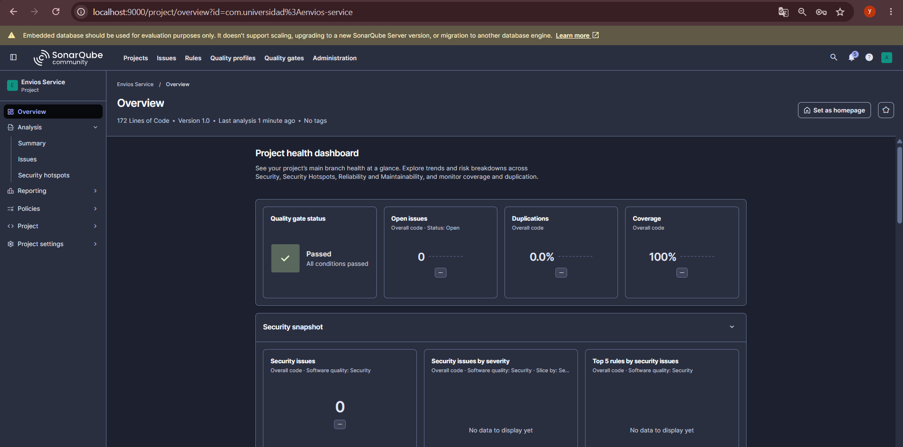

### Complejidad ciclomática por archivo (total 16)

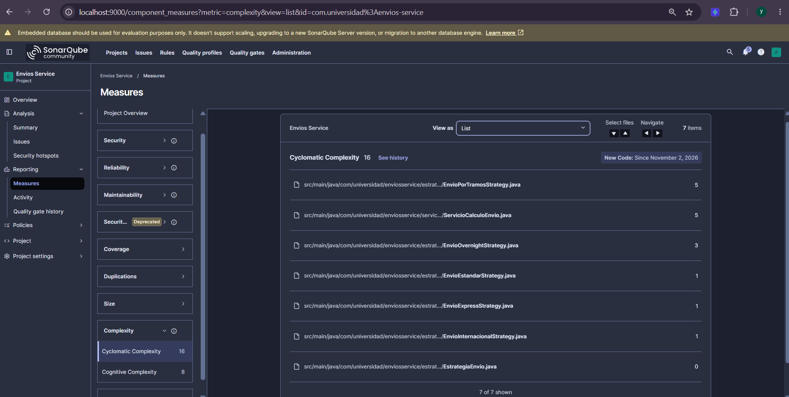

### Cobertura de ramas en código nuevo (100 %, 16 de 16 condiciones)

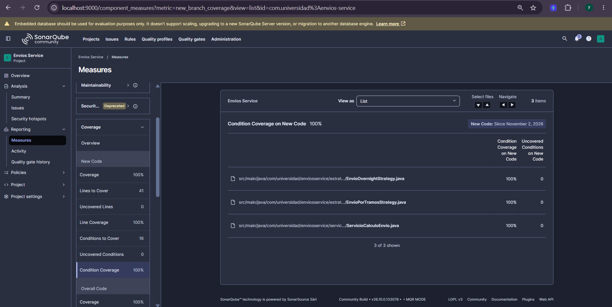

### Reporte HTML de JaCoCo (0 de 16 ramas sin cubrir)

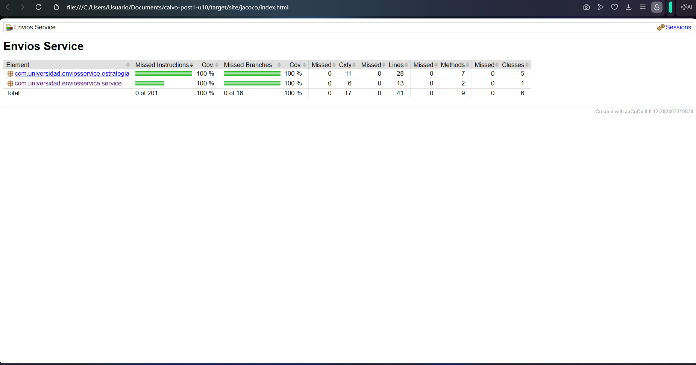

### JaCoCo: código de `ServicioCalculoEnvio` con todas las ramas cubiertas

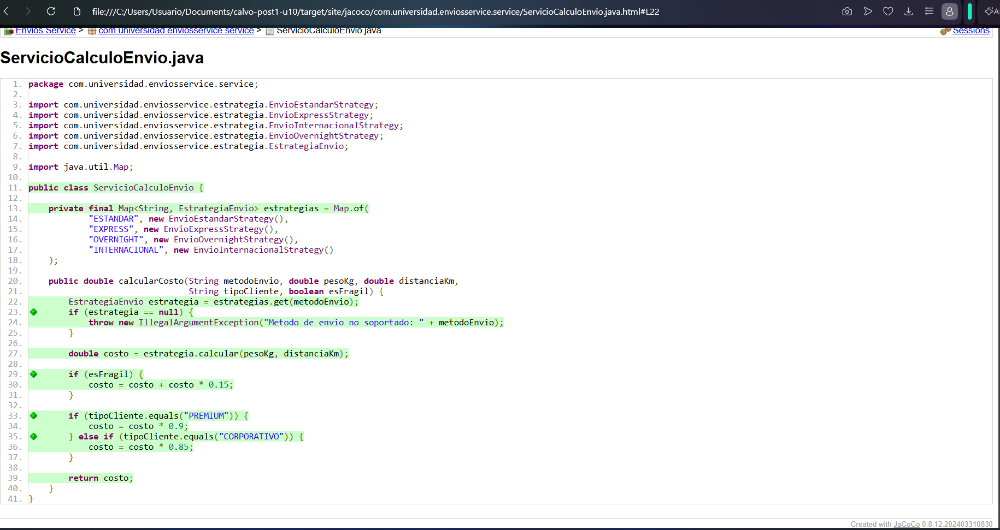

## Cómo reproducir el análisis

```bash
# 1. Levantar SonarQube (esperar "SonarQube is operational")
docker run -d --name sonarqube -p 9000:9000 -e SONAR_ES_BOOTSTRAP_CHECKS_DISABLE=true sonarqube:community

# 2. Compilar, probar y generar el reporte de JaCoCo
mvn clean verify

# 3. Enviar el análisis (el token se genera en My Account > Security)
mvn clean verify sonar:sonar "-Dsonar.token=TU_TOKEN"
```

El reporte de JaCoCo queda en `target/site/jacoco/index.html`. El token no se
guarda en el repositorio.

## Herramientas utilizadas

- Java 21, Apache Maven
- JUnit 5 (pruebas parametrizadas), JaCoCo 0.8.12
- SonarQube Community Build 26.10 (Docker)
- Git, GitHub

## Conclusiones

El diagnóstico mostró que una complejidad ciclomática de 20 y una cobertura de
ramas de 18.4 % pueden convivir con 0 Code Smells, porque las reglas que miden
complejidad no estaban activas en el perfil por defecto: las métricas no
alertan solas, hay que configurar el umbral. Elegir Strategy por la naturaleza
de los condicionales (valor discreto, sin estado ni orden) redujo la
complejidad máxima por método de 20 a 5 y la cognitiva de 32 a 8, y dejar la
fragilidad y el descuento de cliente en el orquestador evitó duplicar reglas
transversales. Las pruebas se escribieron rama por rama contra el reporte de
JaCoCo, con valores esperados verificables, de modo que el 100 % de cobertura
sea consecuencia de comprobar comportamiento y no de llenar el número. Lo más
instructivo fue que el Quality Gate falló por duplicación justo después de un
refactor que parecía correcto, y la solución fue mejorar el diseño con una
clase base y no relajar el umbral.