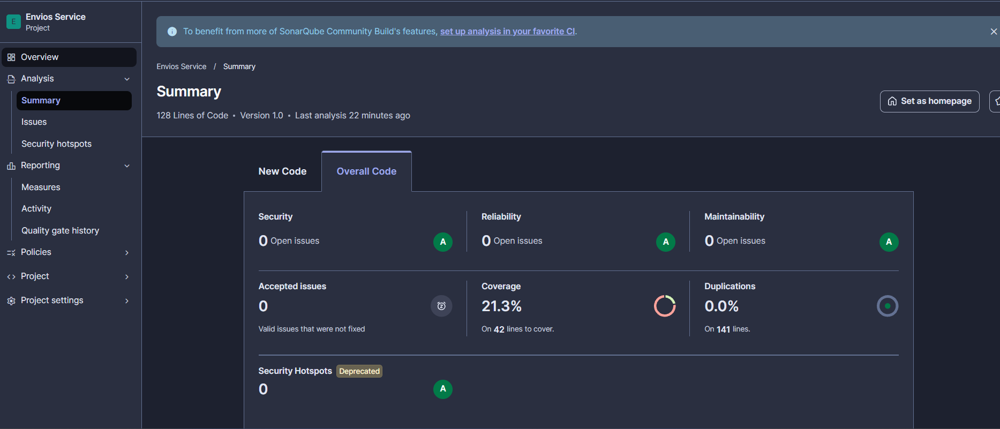
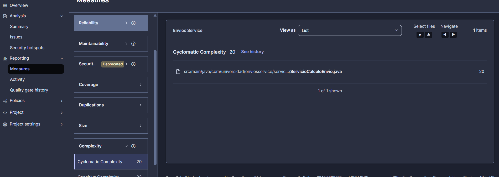
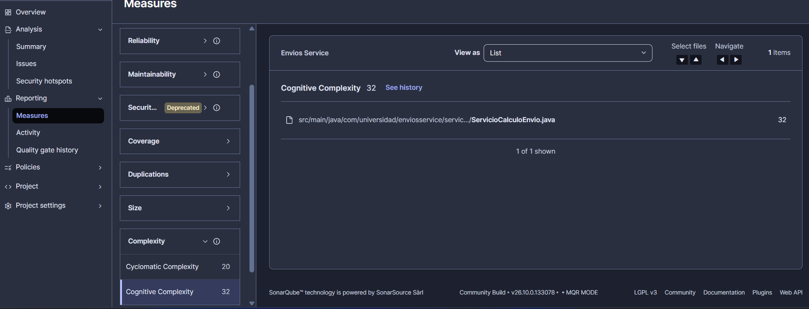
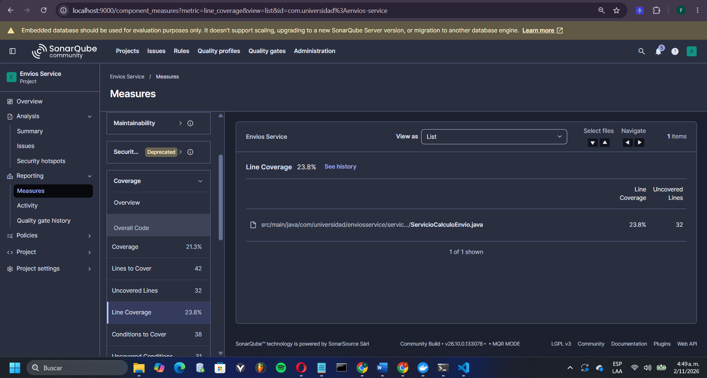
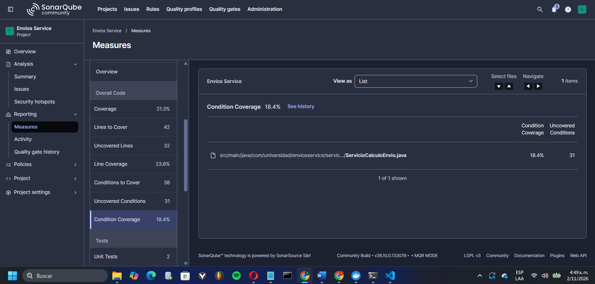
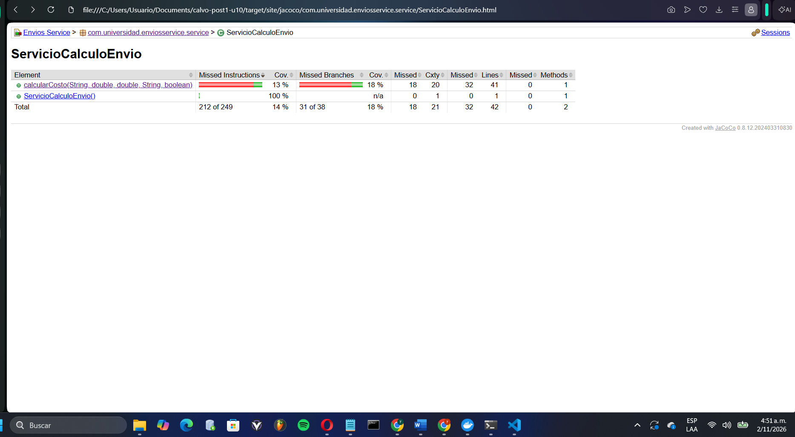
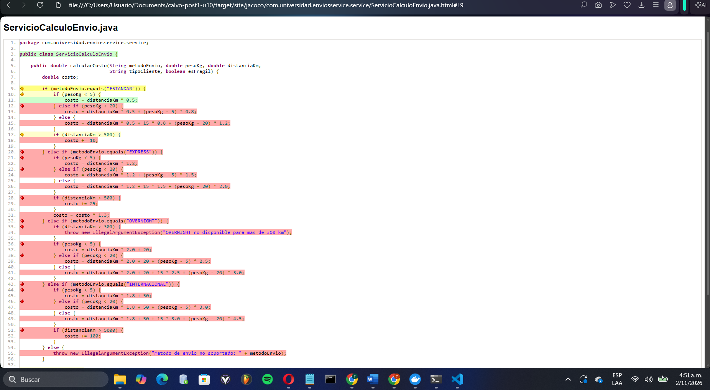
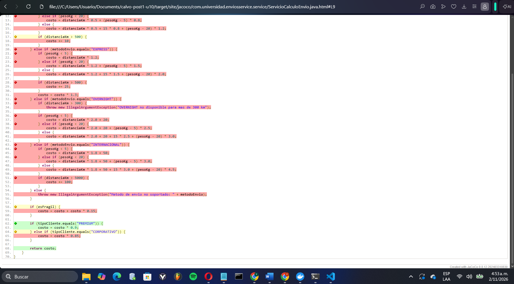
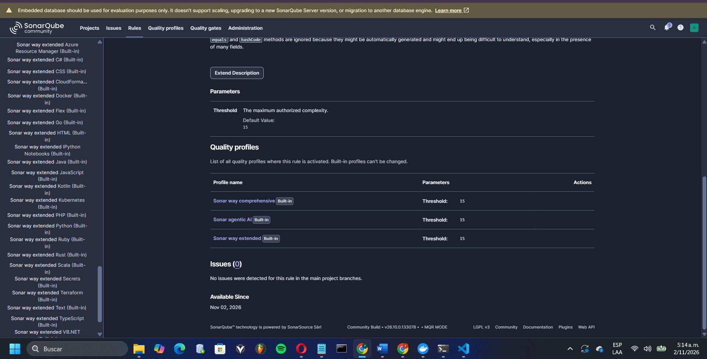
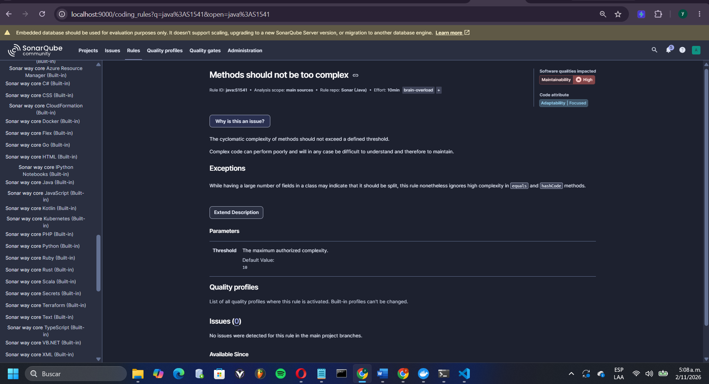

# Envios Service — Diagnóstico y Mejora Guiada por Métricas

Proyecto Maven (Java 21) que calcula el costo de un envío según el método de
transporte, el peso, la distancia, la fragilidad del paquete y el tipo de
cliente. Se usa para diagnosticar la calidad del código con **SonarQube** y
**JaCoCo** y, después, mejorarlo con evidencia medible.

## Entorno de análisis

**Decisión de diseño 1: SonarQube local con Docker (imagen `sonarqube:community`)**

Elegí ejecutar SonarQube localmente con Docker en lugar de SonarCloud por los
siguientes criterios:

1. **Independencia de conectividad y de límites de plan:** el análisis, el
   Quality Profile y el Quality Gate se ejecutan y configuran sin depender de
   internet ni de las restricciones de un plan gratuito, lo que permite
   re-ejecutar el análisis las veces necesarias en la Parte 2.
2. **Control total de la configuración:** al administrar mi propia instancia
   puedo duplicar el perfil de calidad por defecto ("Sonar way core"), activar
   la regla `java:S1541` con Threshold = 10 y asignar un Quality Gate
   personalizado sin restricciones.
3. **Coherencia con la configuración del proyecto:** el archivo
   `sonar-project.properties` apunta a `http://localhost:9000`, y el proyecto
   puede analizarse sin estar publicado previamente en un repositorio remoto.

**Costo asumido:** Docker consume recursos de la máquina local (aprox. 2 GB de
RAM) y el contenedor debe mantenerse en ejecución durante todo el laboratorio.
Lo acepté porque el proyecto es pequeño y el beneficio en control y
repetibilidad supera ese costo.

**Configuración:** SonarQube Community Build 26.10, proyecto `envios-service`,
project key `com.universidad:envios-service`, autenticación mediante token de
análisis (no incluido en el repositorio por seguridad; se pasa por línea de
comandos con `-Dsonar.token`).

**Decisión de diseño 2: Exclusiones del análisis — no se excluye ninguna clase**

No configuré `sonar.exclusions` y analizo todo el código de `src/main/java`.

1. **No existe código sin lógica propia.** El proyecto es un Maven plano (sin
   Spring Boot) y no tiene clase `Main`, controladores, configuración ni DTOs.
   La única clase de producción es `ServicioCalculoEnvio`, que contiene toda
   la lógica de negocio.
2. **Excluir distorsionaría la métrica.** Dejar fuera `ServicioCalculoEnvio`
   ocultaría justamente el problema que el laboratorio busca diagnosticar
   (complejidad alta y cobertura baja). Excluir código para "mejorar" el
   porcentaje sería maquillar el resultado.
3. **Aplica también a la Parte 2.** Las clases del paquete `estrategia`
   contienen fórmulas de cálculo reales, por lo que deben medirse y no
   excluirse.

Si el proyecto incorporara una clase de arranque sin lógica propia, sería
razonable excluirla con `sonar.exclusions` para que su falta de pruebas no
distorsione la cobertura global.

## Estado inicial del análisis

Valores observados en el dashboard de SonarQube y en el reporte HTML de JaCoCo
tras ejecutar `mvn clean verify sonar:sonar`, antes de modificar el código.

| Métrica | Valor real observado |
|---------|----------------------|
| Complejidad ciclomática de `calcularCosto()` | 20 |
| Complejidad cognitiva de `calcularCosto()` | 32 |
| Cobertura de líneas de `ServicioCalculoEnvio` | 23.8 % (32 de 42 líneas sin cubrir) |
| Cobertura de ramas de `ServicioCalculoEnvio` | 18.4 % en SonarQube (31 de 38 condiciones sin cubrir); 18 % en JaCoCo (31 de 38 ramas sin cubrir) |
| Cobertura global (líneas + ramas) | 21.3 % |
| Code Smells reportados | 0 |
| Líneas duplicadas | 0.0 % |
| Pruebas ejecutadas | 2 (sin fallos) |
| Quality Gate (por defecto) | Passed |

## Interpretación

**Qué método concentra el problema.** `ServicioCalculoEnvio.calcularCosto()` es
el único método con lógica de la clase (el constructor por defecto tiene
complejidad 1 y 100 % de cobertura), por lo que la complejidad de la clase
(20) es la del método. La complejidad alta y la cobertura baja apuntan al
mismo método: `calcularCosto()` concentra una cadena de cuatro métodos de
envío, tramos de peso, recargos por distancia, fragilidad y tipo de cliente,
y la suite inicial solo ejercita dos caminos (ESTANDAR con peso menor a 5 kg,
con cliente REGULAR y PREMIUM). Con 20 caminos independientes frente a 2
pruebas, es esperable que la cobertura de ramas sea baja.

**Ramas sin cubrir según el reporte JaCoCo** (solo 7 de 38 ramas cubiertas):

| Zona del método (líneas) | Estado |
|---|---|
| `ESTANDAR`, tramos de peso 5–20 kg y mayor a 20 kg (12–15) | Sin ejecutar |
| `ESTANDAR`, recargo `distanciaKm > 500` (17–18) | Solo la rama falsa cubierta |
| Bloque completo `EXPRESS` (20–31) | Sin ejecutar |
| Bloque completo `OVERNIGHT`, incluida la excepción de más de 300 km (32–42) | Sin ejecutar |
| Bloque completo `INTERNACIONAL`, incluido el recargo de más de 5000 km (43–52) | Sin ejecutar |
| Excepción de método de envío no soportado (54–55) | Sin ejecutar |
| Recargo por fragilidad `esFragil` (58–59) | Solo la rama falsa cubierta |
| Descuento `CORPORATIVO` (64–65) | Evaluado, pero nunca verdadero |

**Decisión de diseño 3: métrica usada como señal principal — Cognitive Complexity**

En este proyecto las tres señales (complejidad ciclomática, complejidad
cognitiva y cobertura) coinciden en `calcularCosto()`, porque es el único
método con lógica. Aun así, usé la **complejidad cognitiva (32)** como señal
principal para elegir el método a intervenir, por estas razones:

1. **Es mayor que la ciclomática (32 frente a 20).** La diferencia de 12
   puntos viene de la penalización por anidamiento: los `if` de tramos de
   peso están dentro de cada bloque de método de envío. La ciclomática solo
   cuenta caminos; la cognitiva refleja además lo difícil que es leer el
   método, que es el verdadero costo de mantenerlo.
2. **Apunta a la causa, no solo al síntoma.** El anidamiento por método de
   envío es justamente lo que un patrón de diseño puede eliminar, mientras
   que la cobertura baja es consecuencia de tener tantos caminos.
3. **Uso complementario de las otras dos.** La complejidad ciclomática (20)
   es la métrica con la que mediré la reducción antes y después (y la que
   controla la regla `java:S1541` del Quality Profile), y la cobertura de
   ramas guiará qué pruebas escribir en la Parte 2.

**Hallazgo adicional: 0 Code Smells a pesar de la complejidad alta.**
`calcularCosto()` tiene complejidad ciclomática 20 y complejidad cognitiva 32,
y aun así SonarQube reporta 0 Code Smells. La causa es de configuración, no de
código: el perfil de calidad que usa el proyecto ("Sonar way core", 274 reglas
activas para Java) no activa ninguna de las dos reglas que miden estos valores:

| Regla | Umbral por defecto | Perfiles donde está activa | ¿Activa en "Sonar way core"? |
|---|---|---|---|
| `java:S1541` (Methods should not be too complex) | 10 | ninguno | No |
| `java:S3776` (Cognitive Complexity of methods should not be too high) | 15 | Sonar way extended, comprehensive y agentic AI | No |

Con los umbrales por defecto (10 y 15), los valores 20 y 32 superarían ambos
límites, por lo que el método sería reportado si las reglas estuvieran
activas. Esto confirma que una métrica de complejidad no genera alertas por
sí sola: hay que activar la regla y fijar el umbral de forma explícita en un
Quality Profile, lo que se hace en la Parte 2.

## Capturas del análisis inicial

### Dashboard de SonarQube

### Complejidad ciclomática (20)

### Complejidad cognitiva (32)

### Cobertura de líneas (23.8 %)

### Cobertura de ramas (18.4 %)

### Reporte HTML de JaCoCo

### JaCoCo: ramas sin cubrir en el código de `calcularCosto()`

### Reglas de complejidad no activas en el perfil del proyecto

## Herramientas utilizadas

- Java 21, Apache Maven
- JUnit 5, JaCoCo 0.8.12
- SonarQube Community Build 26.10 (Docker)
- Git, GitHub